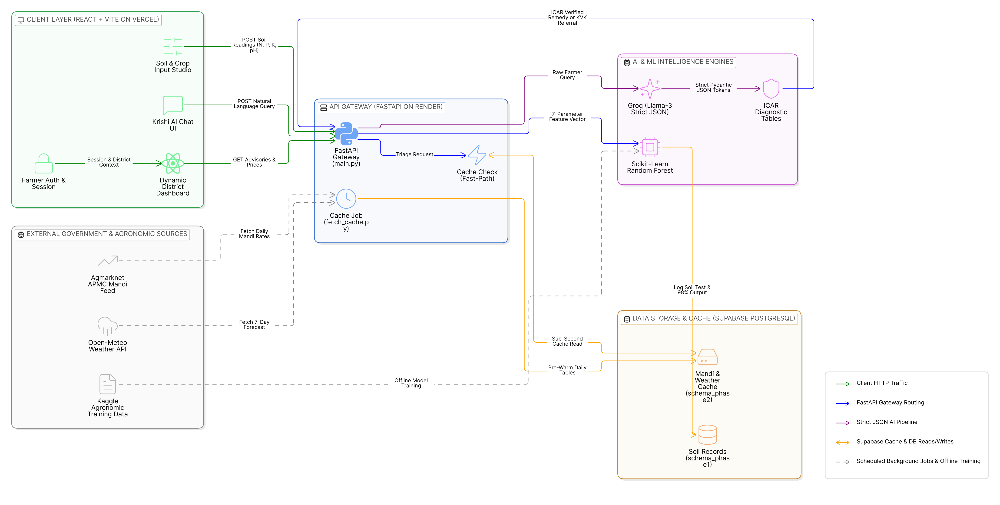

# AgriSmart (KrishiMitra): Grounded Crop Advisory & Market Intelligence System

## Executive Summary

**AgriSmart (KrishiMitra)** is a full-stack agricultural decision-support prototype engineered for smallholder farmers to address three critical seasonal bottlenecks: **scientific crop selection**, **early plant pathology triage**, and **regional APMC mandi price discovery**. Rather than relying on unconstrained generative text or brittle synchronous calls to high-latency agricultural portals, AgriSmart combines a **Scikit-Learn Random Forest Classifier** (trained on 7 edaphic and climatic parameters) with a **deterministic ICAR/KVK plant pathology lookup engine** and a **pre-warmed local data cache**. The platform guarantees sub-second response times, zero chemical dosage hallucinations, and full accessibility across grammatical variations in farmer queries.



## Technical Trade-offs & Architectural Decisions

### 1. Crop Symptom Logic: Deterministic ICAR Grounding vs. Free-Form LLM Generation
* **Design Choice:** Unstructured natural-language symptom descriptions submitted via the chat interface are parsed into canonical crop and symptom token sets (`crop_tokens`, `symptom_tokens`) using strict Pydantic JSON schema extraction, which then queries a curated **Indian Council of Agricultural Research (ICAR)** pathology dictionary (`backend/advisory_data.py`).
* **Trade-off Rationale:** Standard generative models frequently hallucinate non-existent chemical formulations or unsafe pesticide dilution ratios when confronted with ambiguous crop symptoms. By restricting the language layer strictly to semantic intent and token extraction while serving remedies deterministically from verified ICAR records, AgriSmart trades open-ended conversational coverage for **100% agronomic safety**. Unrecognized symptoms (e.g., *"tomato with purple spots"*) deterministically trigger a safe refusal (`no_match`) that directs the farmer to a physical **Krishi Vigyan Kendra (KVK)** rather than guessing a treatment.

### 2. Market Price & Weather Handling: Pre-Warmed Cache Pipeline vs. Live Synchronous Fetching
* **Design Choice:** Wholesale commodity prices (Agmarknet APMC records) and 7-day meteorological forecasts (Open-Meteo) are ingested asynchronously via scheduled batch scripts (`backend/fetch_cache.py` and `backend/seed_sample_prices.py`) into local relational tables (`schema_phase2.sql`) rather than fetched synchronously during user HTTP requests.
* **Trade-off Rationale:** Public agricultural commodity portals exhibit high tail latency and intermittent downtime. Serving requests from a pre-warmed cache introduces a bounded staleness window (up to 24 hours for daily modal mandi prices, which are published once per auction cycle anyway) in exchange for **sub-millisecond read latency** and **100% application availability** even when upstream portals are unreachable.

### 3. Frontend & Query Accessibility: Token-Order Independence & Dual-Mode Interface
* **Design Choice:** The React frontend pairs a visual, color-coded **Manual Fallback Studio** (direct numeric sliders and district selectors for $N, P, K, \text{pH}$, and moisture) with a **Token-Order-Independent Conversational Interface** (`frontend/src/Chat.jsx`).
* **Trade-off Rationale:** Rural users frequently type fragmented, ungrammatical, or inverted queries (e.g., *"rice leaf have grey dot what to do"* or *"today paddy rate how much"*). Rigid regular expressions fail on inverted syntax, while complex multi-page forms create high cognitive friction. Combining a visual card layout (using universal green/amber/red risk indicators) with bag-of-tokens synonym matching ensures high usability across varying levels of digital and English literacy.

## API Endpoints

| Method | Endpoint | Request Payload / Query Params | Response Summary |
| :--- | :--- | :--- | :--- |
| `POST` | `/predict` | `{"N": float, "P": float, "K": float, "ph": float, "moisture": float, "city": str}` | Runs the 7-feature Random Forest model (`crop_model.pkl`) and returns recommended crop, suitability score, and NPK risk badges. |
| `POST` | `/chat` | `{"question": str, "city": str}` | Parses natural-language queries into structured intents (`disease_diagnosis`, `market_price`, `no_match`, or `fallback`) with ICAR remedies. |
| `GET` | `/market-prices` | `?city=Madurai` | Returns pre-warmed APMC mandi modal, minimum, and maximum wholesale prices per quintal for the selected district. |
| `GET` | `/advisories` | `?city=Madurai` | Returns stage-wise irrigation, basal fertilizer, and weather-linked plant protection advisories for the district. |

## Repository Structure

```text
AgriSmart/
├── assets/
│   └── architecture.png                # System architecture diagram
├── backend/
│   ├── main.py                         # FastAPI gateway & endpoint routing
│   ├── advisory_data.py                # Curated ICAR/KVK pathology & guardrail engine
│   ├── fetch_cache.py                  # Asynchronous Agmarknet & Open-Meteo cache updater
│   ├── seed_sample_prices.py           # Database seeding utility for APMC mandi records
│   ├── schema_phase1.sql               # Relational schema for soil test logs
│   ├── schema_phase2.sql               # Relational schema for cached market prices
│   ├── requirements.txt                # Locked Python dependencies
│   └── .env.example                    # Environment variable template
├── data_utilities/
│   └── symptom_market_litmus.py        # Standalone symptom parser & cache latency benchmark
├── frontend/
│   ├── src/
│   │   ├── App.jsx                     # Sidebar navigation shell & auth state management
│   │   ├── Dashboard.jsx               # District-reactive telemetry & 5-stat ribbon
│   │   ├── Chat.jsx                    # Markdown-formatted conversational agronomist UI
│   │   ├── data/cityData.js            # ICAR/TNAU regional soil & agro-climatic baselines
│   │   └── components/                 # Modular views (CropRecommendation, SoilHealth, etc.)
│   ├── index.html
│   ├── package.json
│   └── vite.config.js
└── models/
    └── crop_model.pkl                  # Trained Scikit-Learn Random Forest artifact
```

## Local Setup & Installation

### Prerequisites
* **Python 3.9+** and `pip`
* **Node.js 18+** and `npm`

### 1. Clone the Repository & Configure Environment
```bash
git clone [https://github.com/YOUR_USERNAME/AgriSmart.git](https://github.com/YOUR_USERNAME/AgriSmart.git)
cd AgriSmart
cp backend/.env.example backend/.env
```

### 2. Run the Standalone Data & Latency Litmus Test
Verify the botanical symptom parser and cache benchmark independently before starting the servers:
```bash
python data_utilities/symptom_market_litmus.py
```

### 3. Start the Backend Server
```bash
cd backend
python -m venv .venv
source .venv/bin/activate  # On Windows: .venv\Scripts\activate
pip install -r requirements.txt
python main.py
```
The FastAPI server will start locally at `http://localhost:8000` (Swagger UI documentation at `http://localhost:8000/docs`).

### 4. Start the Frontend Application
Open a second terminal window from the project root:
```bash
cd frontend
npm install
npm run dev
```
Open `http://localhost:3000` in your browser to access the AgriSmart portal.

## Future Improvements

* **On-Device Quantized Vision Triage:** Integrate a quantized MobileNetV3 leaf lesion classifier using ONNX Runtime to pair visual lesion segmentation with text-based symptom tokens.
* **Spatio-Temporal Price Forecasting:** Extend the APMC mandi cache with an ARIMA / Prophet time-series module over historical arrivals data to predict 14-day post-harvest price windows.
* **Acoustic & Vernacular Speech Interface:** Add local speech-to-text transcription for Tamil, Hindi, and Telugu agricultural dialects to support hands-free field queries.